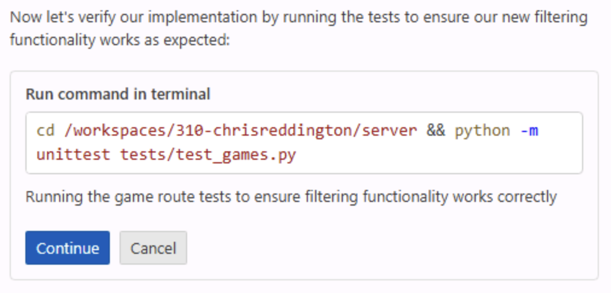

Até as atualizações mais simples de um aplicativo normalmente exigem alterações em vários arquivos e a execução de operações como testes. O fluxo de trabalho de uma pessoa desenvolvedora costuma envolver localizar todos os arquivos necessários, fazer as alterações, executar os testes, depurar, descobrir qual arquivo ficou faltando, fazer outra atualização... E a lista continua.

É nesse contexto que entra o modo de agente do Copilot.

O modo de agente do Copilot foi criado para atuar de forma mais autônoma no IDE. Ele se comporta de maneira semelhante a uma pessoa desenvolvedora: começa explorando a estrutura existente do projeto, realiza as atualizações necessárias, executa tarefas como testes e corrige automaticamente os erros encontrados. Vamos explorar como você pode usar o modo de agente para adicionar novas funcionalidades ao site.

> [!NOTE]
> Embora os nomes sejam parecidos, o modo de agente e o agente de nuvem foram criados para experiências diferentes. O modo de agente executa as tarefas no IDE, permitindo ciclos rápidos de feedback e interação. O agente de nuvem foi projetado para atuar como par de programação, trabalhando de forma assíncrona como integrante da equipe e interagindo com você por meio de issues e pull requests.

Neste exercício, você aprenderá como:

- o modo de agente do Copilot pode explorar seu projeto, identificar arquivos relevantes e fazer alterações coordenadas;
- o modo de agente do GitHub Copilot pode implementar novos recursos na interface do usuário e na camada de dados;
- revisar as alterações e os testes gerados pelo modo de agente do Copilot antes de integrá-los à base de código.

## Cenário

À medida que a lista de jogos cresce, você quer permitir que as pessoas filtrem por categoria e editora. Você já adicionou um helper de editoras no exercício anterior e agora concluirá o restante do trabalho na camada de dados, na interface e nos testes com o modo de agente do Copilot.

## Executar o site Tailspin Toys

Antes de fazer qualquer alteração, vamos explorar o site Tailspin Toys para entender as funcionalidades atuais.

O site é uma plataforma de financiamento coletivo para jogos de tabuleiro com um tema voltado a desenvolvedores. Ele permite listar jogos e exibir detalhes sobre eles. O site é um único aplicativo Astro que renderiza suas páginas como HTML estático durante o build. As páginas consultam diretamente um banco de dados SQLite local no frontmatter, usando o Drizzle ORM — não há uma API de backend separada nem um framework de interface no cliente. Os helpers reutilizáveis de acesso a dados ficam em `src/lib/`, e qualquer interatividade é adicionada com um pequeno `<script>` Astro com escopo definido, usando as APIs padrão do DOM.

### Iniciar o site

Para facilitar a execução do site, há uma tarefa `npm run dev` que inicia o único servidor de desenvolvimento do Astro. Você pode executá-la no GitHub Codespace seguindo estas etapas:

1. Volte ao codespace. Depois do exercício anterior, você deverá estar novamente em `main`.
2. Abra uma nova janela de terminal no Codespace pressionando <kbd>Control</kbd>+<kbd>`</kbd> (Mac) ou <kbd>Ctrl</kbd>+<kbd>`</kbd> (Windows/Linux).
3. Crie e acesse uma nova branch para o trabalho de filtragem:

   ```bash
   git checkout main
   git pull
   git checkout -b filtering-vscode
   ```

4. Execute o seguinte comando para iniciar o site:

   ```bash
   npm run dev
   ```

   Quando o servidor de desenvolvimento do Astro estiver pronto, você verá um banner com a URL, semelhante a este:

   ```bash
   🚀 Tailspin Toys is ready!
      Astro server: http://localhost:4321
      Press Ctrl-C to stop.
   ```

> [!NOTE]
> Se aparecer uma caixa de diálogo perguntando se você quer abrir uma janela do navegador para `http://localhost:4321`, feche-a selecionando o **x**.

5. Abra o site mantendo pressionada a tecla <kbd>Command</kbd> (Mac) ou <kbd>Ctrl</kbd> (Windows/Linux) e selecionando o endereço do servidor Astro `http://localhost:4321` no terminal.

> [!NOTE]
> Ao usar um codespace, selecionar um link para a URL localhost no terminal do Codespace redirecionará automaticamente você para `https://<your-codespace-name>-4321.app.github.dev/`. Esse é um túnel privado para o codespace, que agora está hospedando o servidor web!

### Explorar o site

Depois de iniciar o site, você poderá explorar suas funcionalidades. Os principais recursos do site incluem:

- **Página inicial**: exibe uma lista de jogos de tabuleiro com títulos, imagens e descrições.
- **Página de detalhes do jogo**: ao selecionar um jogo, você acessa uma página com mais informações, incluindo título, descrição, editora e categoria.

## Explorar o backlog com o Copilot

> [!TIP]
> **Abrir o Copilot Chat**
>
> Antes de começar os exercícios abaixo, volte ao codespace, abra o painel do Copilot Chat e selecione **New Chat** para iniciar uma conversa limpa. A seleção de modo e modelo varia conforme o exercício — cada etapa indicará as opções relevantes.

A implementação inicial do site funciona, mas queremos aprimorá-la com novos recursos. Vamos começar revisando o backlog. Quando você criou o projeto a partir do template, um backlog de issues foi criado automaticamente — peça ao GitHub Copilot que mostre esses itens.

1. Selecione **Agent** no menu suspenso de agentes da visualização Chat. O agente **Agent** planeja e implementa alterações de forma autônoma em vários arquivos, executa comandos de terminal e invoca ferramentas.

   

2. Selecione **Claude Sonnet 4.5** na lista de modelos disponíveis.

> [!CAUTION]
> Os autores deste workshop não estão indicando preferência por um modelo específico. Durante a criação do workshop, usamos Claude Sonnet 4.5 e, por isso, o incluímos nas instruções. Esperamos que as sugestões de código recebidas sejam relativamente consistentes, para proporcionar uma boa experiência. No entanto, como os LLMs são probabilísticos, você poderá receber sugestões diferentes das indicadas no workshop. Isso é perfeitamente normal e esperado.

> [!NOTE]
> Devido à natureza probabilística dos LLMs, o Copilot pode usar um comando MCP diferente, mas ainda deverá conseguir concluir a tarefa.

3. Pergunte ao Copilot sobre o backlog de issues enviando o seguinte prompt:

   ```plaintext
   Please show me the backlog of items from my GitHub repository. Help me prioritize them based on those which will be most useful to the user.
   ```

4. Selecione **Continue** para executar o comando que lista todas as issues.
5. Revise a lista de issues gerada.

Observe que o Copilot até priorizou os itens com base naqueles que, segundo ele, serão mais úteis para o usuário.

## Revisar os arquivos de instruções

Antes de iniciar o agente para gerar o código, é um bom momento para revisar o arquivo de instruções que fornecerá contexto ao Copilot. Você usará o arquivo de [interface do usuário (UI)](https://github.com/github-samples/tailspin-toys/blob/main/.github/instructions/ui.instructions.md), que contém orientações sobre como adicionar funcionalidades ao site.

1. No codespace, acesse `.github/instructions/ui.instructions.md`.
2. Observe as orientações gerais para adicionar funcionalidades. Elas incluem:
   - uma visão geral da arquitetura;
   - princípios para o design de componentes, a testabilidade e a acessibilidade;
   - links para arquivos de instruções específicos de vários tipos de arquivos, incluindo:
     - Astro;
     - Tailwind CSS;
     - Drizzle.

> [!TIP]
> Os arquivos de instruções permitem referenciar outros arquivos de instruções e arquivos do projeto. Os caminhos são relativos ao local do arquivo de instruções. Isso permite reutilizar orientações, dividir instruções complexas em partes menores e mais fáceis de gerenciar e fornecer exemplos e modelos.

## Implementar a funcionalidade de filtragem

Para concluir a filtragem, será necessário fazer pelo menos três atualizações distintas no aplicativo:

- adicionar ou refinar a lógica de filtragem restante na camada de dados (`src/lib/`);
- adicionar ou atualizar testes para o comportamento de filtragem;
- atualizar a página com a lista de jogos para incluir a interface de filtragem.

Além disso, os testes precisam ser executados e aprovados antes de integrar tudo à base de código. O modo de agente do Copilot pode realizar essas tarefas por você! Vamos adicionar a funcionalidade.

1. Continue a conversa atual com o Copilot ou inicie outra selecionando **New Chat**.
2. Selecione **Add Context**, **Instructions** e `ui` como arquivo de instruções.

   

3. Confirme que **Agent** continua selecionado no menu suspenso de agentes da visualização Chat.

   

4. Confirme que **Claude Sonnet 4.5** continua selecionado como modelo.
5. Peça ao Copilot que implemente a funcionalidade com base na issue relacionada do backlog, usando o seguinte prompt:

   ```plaintext
   Please update the site to include filtering by publisher and category based on the requirements from the related GitHub issue in the backlog. A publishers helper already exists from the previous exercise, so preserve and refine that work as needed while completing the remaining data-layer, UI, and tests. Ensure all tests are passing before completion. The server is already running, so you do not need to start it up.
   ```

6. Acompanhe o Copilot enquanto ele começa explorando o projeto e localizando os arquivos associados à funcionalidade desejada. Você deverá vê-lo encontrar tanto os helpers da camada de dados e a interface quanto os testes. Em seguida, ele começará a modificar os arquivos e executar os testes.

   

> [!NOTE]
> Você verá que o Copilot executa várias tarefas, como explorar o projeto, modificar arquivos e executar testes. Dependendo da complexidade da tarefa e da base de código, isso pode levar alguns minutos. Durante esse processo, talvez apareçam os botões **Keep** e **Undo** no editor de código. Quando o Copilot terminar, você verá uma opção **Keep** ou **Undo** para cada alteração. Portanto, não é necessário selecioná-las enquanto o trabalho ainda está em andamento.

7. Quando o Copilot solicitar, selecione **Continue** para executar os testes.

   

8. Talvez ocorram pausas e até falhas em alguns testes durante o processo. Não tem problema! O Copilot alterna entre gerar código e executar testes até concluir a tarefa sem detectar erros.

   

9. Explore o código gerado para identificar possíveis problemas.

> [!CAUTION]
> Lembre-se: é sempre importante revisar o código gerado pelo Copilot ou por qualquer outra ferramenta de IA.

10. Volte ao navegador onde o site está em execução. Explore a nova funcionalidade!
11. Depois de confirmar que tudo funciona e revisar o código, selecione **Keep** na janela do Copilot Chat.

## Resumo e próximos passos

Parabéns! Neste exercício, exploramos como usar o modo de agente do GitHub Copilot para adicionar novos recursos ao site Tailspin Toys. Aprendemos como:

- o modo de agente do GitHub Copilot pode implementar novos recursos na interface e na camada de dados;
- o modo de agente do Copilot pode explorar seu projeto, identificar arquivos relevantes e fazer alterações coordenadas;
- revisar as alterações e os testes gerados pelo modo de agente do Copilot antes de integrá-los à base de código.

Agora, vamos [testar o recurso com o servidor Playwright MCP][next-lesson] e abrir um pull request.

### Exercício extra de exploração — Implementar paginação

À medida que a lista de jogos cresce, será necessário habilitar a paginação. Usando as habilidades aprendidas neste exercício, peça ao Copilot que atualize o site para implementar a paginação. Algumas considerações para o código:

- siga as práticas recomendadas existentes, inclusive o uso dos arquivos de instruções atuais;
- pense em como a paginação deve funcionar: por exemplo, se você quer permitir que o usuário selecione o tamanho da página ou se ele deve ser fixo;
- ao criar o prompt, forneça ao Copilot as orientações necessárias para implementar a solução desejada;
- talvez seja necessário iterar com o GitHub Copilot, pedindo alterações e fornecendo contexto. Esse é o fluxo normal ao trabalhar com o Copilot!

## Recursos

- [Modos ask, edit e agent do Copilot: o que fazem e quando usar cada um][choose-mode]
- [Modo de agente no VS Code][vs-code-agent-mode]

[previous-lesson]: ../1-custom-instructions/
[next-lesson]: ../3-mcp/
[choose-mode]: https://github.blog/ai-and-ml/github-copilot/copilot-ask-edit-and-agent-modes-what-they-do-and-when-to-use-them/
[vs-code-agent-mode]: https://code.visualstudio.com/docs/copilot/chat/chat-agent-mode
