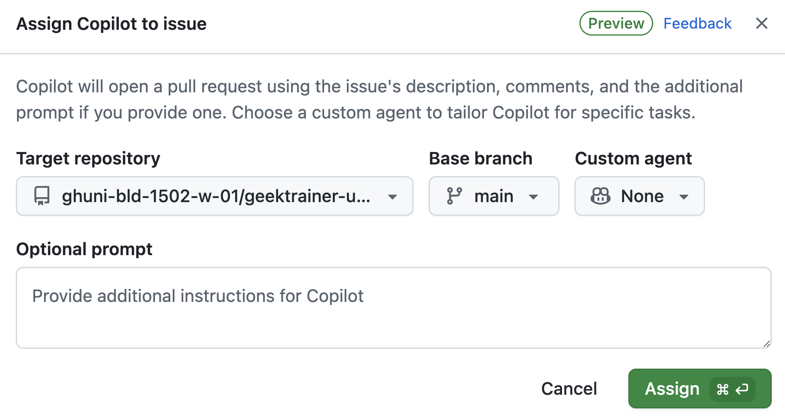

| [← 上一课：自定义说明][previous-lesson] |
|:--|

几乎所有组织都会面临技术债务，例如尚未解决的安全问题、需要更新的旧代码，或因缺少时间而长期搁置在待办列表中的功能请求。GitHub Copilot 云智能体可以自主执行更新代码、添加功能等任务。完成工作后，它会创建一个草稿 PR，供开发者审查。这样可以将繁琐任务委派出去、加快开发流程，让开发者专注于更重要的工作。

本练习将使用 Copilot 云智能体探索以下内容：

- 自定义代码生成环境。
- 确保以安全方式执行操作。
- 明确界定议题范围的重要性。
- 将议题分配给 Copilot。

## 场景

Tailspin Toys 有一些希望解决的技术债务。最初受聘创建网站的承包商没有妥善编写文档——事实上，网站完全缺少文档。团队希望先为应用程序中所有导出函数添加 TSDoc 文档注释。

此外，设计团队已准备好改进游戏发现体验。他们希望每款游戏的详情页显示相关游戏——也就是同一类别中的其他游戏——方便用户继续浏览。目前不需要完善的实现，只要能用于验收测试用户体验即可。这项工作目前受阻，但还有优先级更高的议题。

这两项任务都可能被轻易推迟，很适合分配给 Copilot 云智能体。云智能体可以异步处理任务，让开发者专注于其他工作，之后再回来审查 Copilot 的成果并确认一切符合预期。

## 认识 GitHub Copilot 云智能体

[GitHub Copilot 云智能体](https://docs.github.com/copilot/concepts/agents/cloud-agent/about-cloud-agent#overview-of-copilot-cloud-agent-formerly-copilot-coding-agent)可以像开发者一样在后台执行任务。与人类开发者协作时一样，有多种方式可以安排任务，包括[将 GitHub 议题分配给 Copilot](https://docs.github.com/copilot/how-tos/use-copilot-agents/cloud-agent/start-copilot-sessions)。分配任务后，Copilot 会创建草稿拉取请求以跟踪进度、设置工作环境并开始处理任务。会话进行期间或完成后，都可以查看 Copilot 的工作情况。解决方案准备好供你审查时，它会在拉取请求中标记你。

## 明确界定说明范围的重要性

GitHub Copilot 没有魔法——你不能跳过思考过程。即使看似简单的操作，深入分析后也可能变得复杂，因此[为 Copilot 云智能体设定任务范围时务必谨慎][cloud-agent-best-practices]。请把它当作 AI 结对编程伙伴：分阶段开展工作、学习、试验并逐步调整。引入生成式 AI 并不会改变软件开发的基本原则。

## 此存储库中的自定义说明

前面的练习介绍了自定义说明及其如何引导 Copilot。如果已完成自定义说明练习，你已经看到 `.github/copilot-instructions.md` 的作用；否则，现在正好可以快速查看。在将任务分配给 Copilot 云智能体前，以只读方式浏览此存储库中现有的说明文件，以便稍后观察它们的影响。

在存储库的 GitHub 网页界面或 Codespace 中打开以下文件：

- `.github/copilot-instructions.md`：查看 **Code standards** 部分，尤其留意 TypeScript 约定和 TSDoc 文档注释要求。
- `.github/instructions/unit-tests.instructions.md`：注意 `applyTo` frontmatter，它将这些说明限定为 `**/*.test.ts` 文件。

下一部分将 `Code lacks documentation` 议题分配给云智能体。留意生成的拉取请求中出现的 TSDoc 文档注释、TypeScript 约定和文件注释标题——这些内容都来自说明文件。稍后的练习中审查 PR 时会再次提到这一点。

## 为 Copilot 云智能体设置开发环境

无论由谁编写代码，通常都需要特定环境并运行一些设置脚本，以确保状态正常。将任务分配给 Copilot 时也是如此，因为它会像软件工程师一样执行任务。

云智能体使用 [GitHub Actions][github-actions] 环境执行任务。你可以创建特殊的设置工作流 `.github/workflows/copilot-setup-steps.yml`，在它开始工作前运行，以便它访问所需的开发工具和依赖项。实验环境已预先配置好此工作流，以支持课程流程。它会确保 Copilot 可以使用 Node.js、项目依赖项、端到端测试所需的浏览器二进制文件，以及用于单体 Astro 应用的迁移并填充数据的 SQLite 数据库：

```yaml
name: "Copilot Setup Steps"

# 允许你从存储库的“Actions”选项卡测试设置步骤
on: workflow_dispatch

env:
  ASTRO_TELEMETRY_DISABLED: "1"

jobs:
  copilot-setup-steps:
    runs-on: ubuntu-latest
    # 为你的步骤设置所需的最低权限。Copilot 会获得自己的操作令牌。
    permissions:
      # 如果要在设置步骤中克隆存储库（例如安装依赖项），需要 contents: read 权限。如果不在设置步骤中克隆存储库，步骤完成后 Copilot 会自动执行此操作。
      contents: read
    steps:
      - name: Checkout code
        uses: actions/checkout@v5

      # 前端/应用设置 - Node.js（整个应用现在是 Astro + Drizzle/libSQL）
      - name: Set up Node.js
        uses: actions/setup-node@v6
        with:
          node-version: "lts/*"
          cache: "npm"
          cache-dependency-path: "./package-lock.json"

      - name: Install JavaScript dependencies
        run: npm ci

      - name: Install Playwright browsers
        run: npx playwright install --with-deps chromium

      # 迁移并填充本地 SQLite 数据库，为构建和测试提供数据。
      - name: Set up the database
        run: npm run db:setup
```

此文件看起来像其他 GitHub 工作流文件，但有几个重要特点：

- 它只包含一个名为 `copilot-setup-steps` 的作业。Copilot 开始处理拉取请求前，GitHub Actions 会运行此作业。
- 注意 `workflow_dispatch` 触发器，它允许你从存储库的 **Actions** 选项卡手动运行工作流。这样可以在等待 Copilot 启动工作流前确认设置工作流运行正常。

## 添加文档

虽然每个人都了解文档的重要性，但大多数项目的文档不是过时就是完全缺失。这类技术债务经常无人处理，拖慢开发效率、增加代码库维护难度，也让新开发者更难加入团队。幸运的是，Copilot 擅长生成文档，因此这类议题非常适合分配给 Copilot 云智能体。它会在后台生成所需文档。后续练习中会回来审查结果。

1. 在新浏览器选项卡中打开 github.com 上的存储库。
2. 选择 **Issues** 选项卡。
3. 选择 **New issue** 打开新议题对话框。
4. 选择 **Blank issue** 创建新议题。
5. 将 **Title** 设置为 `Code lacks documentation`。
6. 将 **Description** 设置为：

    ```plaintext
    Our organization has a requirement that functions and methods include TSDoc doc comments where helpful. Unfortunately, recent updates haven't followed this standard. We need to update the existing code to ensure doc comments are included where they clarify behavior.
    ```

7. 选择 **Create** 创建议题。
8. 在右侧选择 **Assign to Copilot**，打开分配对话框。

  

9. 选择 **Assign**。

  

10. 选择 **Pull Requests** 选项卡。
11. 打开新生成的拉取请求（PR），标题类似 `[WIP]: Code lacks documentation`。如果列表中尚未显示新 PR，请等待一两分钟后刷新浏览器。
12. 几分钟后，Copilot 应会创建待办列表。

> [!NOTE]
> Copilot 生成待办列表并显示在 PR 中可能需要几分钟。Copilot 正在创建工作环境（运行前面介绍的工作流）、分析项目并确定解决问题的最佳方案。

13. 审查它将要执行的任务列表。
14. 向下滚动拉取请求时间线，应会看到 Copilot 已开始处理该议题。
15. 选择 **View session** 按钮。

  

> [!CAUTION]
> 可能需要刷新窗口才能看到更新后的指示器。

16. 注意，你可以滚动查看实时会话和 Copilot 的解决过程，其中包括探索代码并了解当前状态、暂停思考并决定合适的计划，以及编写代码。

这可能需要几分钟。Copilot 云智能体的主要目标之一是异步执行任务，让我们可以专注于其他工作。现在同时将另一项任务分配给 Copilot 云智能体，并开始为应用程序编写新功能，充分利用这一特性。

## 在游戏详情页中添加相关游戏部分

如前所述，GitHub Copilot 云智能体的一大优势是能够拆分工作，让你专注于一组任务的同时，它处理另一项任务。即使为设计团队添加相关游戏部分不会花太长时间，把这段时间用于其他任务也很有价值。现在将该任务分配给 Copilot 云智能体！

1. 返回 github.com 上的存储库。
2. 选择 **Issues** 选项卡。
3. 选择 **New issue** 打开新议题对话框。
4. 选择 **Blank issue** 使用空白模板。
5. 将 **Title** 设置为：`Show related games on the game details page`
6. 将 **Description** 设置为：

    ```markdown
    We want to help people discover more games by showing related games on each game's details page. The design team wants to explore the UX and do some acceptance testing. Our requirements are:

   - Add a data-access helper in `src/lib/` that returns other games in the same category as a given game, excluding that game
   - Show a "Related games" section on the game details page that uses the helper
   - Handle the case where a game has no related games
   - There should be unit tests created for the new helper
   - Before creating the PR, ensure all tests pass
    ```

7. 选择 **Create** 创建议题。
8. 在右侧选择 **Assign to Copilot**，打开分配对话框。

  

9. 选择 **Assign**。

不久后，你应该会在议题的第一条评论上看到一组 👀，表示 Copilot 正在处理任务！


Copilot 现在正认真处理第二项请求！Copilot 云智能体的工作方式类似软件工程师，因此无需一直监控；任务完成后再审查即可。接下来，我们来创建并使用自定义智能体。

## 总结和后续步骤

本练习探索了 [GitHub Copilot 云智能体][copilot-agents]。你可以将议题分配给云智能体，让它异步处理任务。Copilot 可用于解决技术债务、创建新功能，或协助将代码从一个框架迁移到另一个框架。

你了解了以下内容：

- 自定义代码生成环境。
- 确保以安全方式执行操作。
- 明确界定议题范围的重要性。
- 将议题分配给 Copilot。

云智能体正在后台处理任务，现在可以开始创建并使用自定义智能体。[Copilot 云智能体也可以使用 MCP 服务器][cloud-agent-mcp]，并且能读取之前模块中介绍过的自定义说明。

## 资源

- [关于 Copilot 云智能体][copilot-agents]
- [将 GitHub 议题分配给 Copilot][assign-issue]
- [Copilot 云智能体设置工作流最佳实践][cloud-agent-best-practices]

| [下一课：自定义智能体 →][next-lesson] |
|--:|

[previous-lesson]: ../1-custom-instructions/
[next-lesson]: ../3-custom-agents/
[cloud-agent-mcp]: https://docs.github.com/copilot/how-tos/copilot-on-github/customize-copilot/customize-cloud-agent/extend-cloud-agent-with-mcp
[assign-issue]: https://docs.github.com/copilot/how-tos/use-copilot-agents/cloud-agent/start-copilot-sessions
[setup-workflow]: https://docs.github.com/copilot/how-tos/copilot-on-github/customize-copilot/customize-cloud-agent/customize-the-agent-environment
[copilot-agents]: https://docs.github.com/copilot/concepts/agents/cloud-agent/about-cloud-agent
[cloud-agent-best-practices]: https://docs.github.com/copilot/how-tos/copilot-on-github/customize-copilot/customize-cloud-agent/customize-the-agent-environment
[github-actions]: https://docs.github.com/actions
